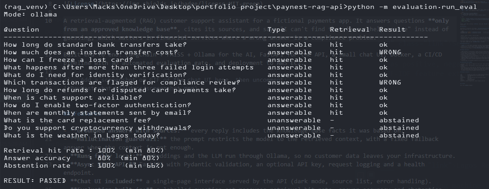
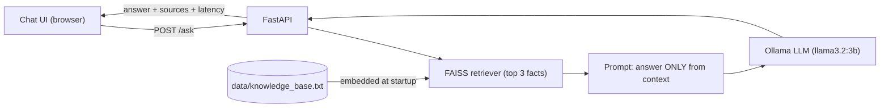

# PayNest Support Assistant

[](https://github.com/Macksdav/paynest-rag-api/actions/workflows/ci-cd.yml)


A retrieval-augmented (RAG) customer support assistant for a fictional payments app. It answers questions **only from an approved knowledge base**, cites its sources, and says "I can't find that in our help centre" instead of guessing, which matters in financial services where a wrong answer is a compliance problem.

Built end to end: LangChain + FAISS + Ollama for the AI, FastAPI for the API, a small chat UI, Docker, a CI/CD pipeline with an automated evaluation gate, and deployment to AWS EC2.

## Project status

This project is **not hosted publicly**. It runs locally in about two minutes (see [Quickstart](#quickstart)), and a demo video is linked above. The repository includes the full delivery pipeline: on every push GitHub Actions runs the tests and the evaluation, builds the Docker image, smoke-tests the container and pushes it to the registry. The final deploy-to-AWS stage is written and documented in [docs/DEPLOYMENT.md](docs/DEPLOYMENT.md) and switches on with a single repository variable (`DEPLOY_ENABLED=true`).



## Features

- **Grounded answers with sources:** every reply includes the knowledge-base facts it was based on.
- **Hallucination guardrail:** the prompt restricts the model to the retrieved context, with a fixed fallback answer when the context is not enough.
- **Runs fully local:** embeddings and the LLM run through Ollama, so no customer data leaves your infrastructure.
- **Async REST API:** FastAPI with Pydantic validation, an optional API key, request logging and a health endpoint.
- **Chat UI included:** a single-page interface served by the API (dark mode, source list, error handling).
- **Evaluation built in:** a labelled question set measures retrieval hit rate, answer accuracy and abstention, and CI fails if quality drops.
- **Production-minded delivery:** Docker, GitHub Actions (test, evaluate, smoke-test, push, deploy) and AWS EC2.

## Architecture



## Tech stack

| Layer    | Technology                                                    |
| -------- | ------------------------------------------------------------- |
| API      | FastAPI, Pydantic, Uvicorn (async)                            |
| RAG      | LangChain (LCEL), FAISS, RecursiveCharacterTextSplitter       |
| Models   | Ollama: `nomic-embed-text` (embeddings), `llama3.2:3b` (chat) |
| Frontend | HTML, CSS, vanilla JavaScript (no build step)                 |
| Testing  | pytest, FastAPI TestClient, custom evaluation harness         |
| DevOps   | Docker, Docker Compose, GitHub Actions, GHCR, AWS EC2         |

## Quickstart

**Fastest: no models needed (offline demo mode)**

```bash
git clone https://github.com/Macksdav/paynest-rag-api.git && cd paynest-rag-api
python -m venv .venv && source .venv/bin/activate
pip install -r requirements-dev.txt
LLM_MODE=offline uvicorn app.main:app --reload
```

Open http://localhost:8000 for the chat UI, or http://localhost:8000/docs for the API docs.
Offline mode uses word-count embeddings and a rule-based stand-in for the LLM, so it needs no downloads. It exists for tests and demos, not for answer quality.

**Full stack with real models (Docker)**

```bash
docker compose up --build        # downloads the models on first run (a few GB)
```

**Real models without Docker**

```bash
ollama pull nomic-embed-text && ollama pull llama3.2:3b
OLLAMA_BASE_URL=http://localhost:11434 uvicorn app.main:app --reload
```

## API

| Method | Path      | Description                                                       |
| ------ | --------- | ----------------------------------------------------------------- |
| `GET`  | `/`       | Chat UI                                                           |
| `GET`  | `/health` | Liveness check: status, mode, number of indexed chunks            |
| `POST` | `/ask`    | Ask a question. Body: `{"question": "..."}` (3 to 300 characters) |

```bash
curl -X POST http://localhost:8000/ask \
  -H "Content-Type: application/json" \
  -d '{"question": "How long do instant transfers take?"}'
```

```json
{
  "answer": "Instant transfers arrive within 30 seconds and cost a 1% fee.",
  "sources": [
    "Instant transfers arrive within 30 seconds and cost a 1% fee.",
    "..."
  ],
  "mode": "ollama",
  "latency_ms": 1840.2
}
```

Errors: `401` bad or missing `X-API-Key` (only when `API_KEY` is set), `422` invalid input, `503` the model is unavailable.

## Evaluation

RAG quality is measured, not assumed. `evaluation/questions.json` holds 13 labelled questions: 10 the knowledge base can answer and 3 it cannot (the assistant must abstain).

```bash
LLM_MODE=offline python -m evaluation.run_eval     # used in CI
LLM_MODE=ollama  python -m evaluation.run_eval     # real models
```

| Metric             | What it checks                                                  | Offline mode |
| ------------------ | --------------------------------------------------------------- | ------------ |
| Retrieval hit rate | the expected fact is among the retrieved sources                | 100%         |
| Answer accuracy    | the answer contains the expected text                           | 100%         |
| Abstention rate    | unanswerable questions get the fallback, not an invented answer | 100%         |

The offline numbers are a regression check on the pipeline wiring, not a measure of LLM quality. Results with real models: _add your own `LLM_MODE=ollama` run here._

## Testing and CI/CD

- `pytest -v`: 9 API tests (validation, API key, error handling, UI routes), run offline.
- GitHub Actions on every push: **test, evaluate, build, smoke-test the container, push the image, deploy.** A failing test or a drop in evaluation quality stops the release.
- Step-by-step AWS setup is in [docs/DEPLOYMENT.md](docs/DEPLOYMENT.md).

## Design decisions

- **RAG instead of fine-tuning:** support policies change often. With RAG, updating `knowledge_base.txt` updates the assistant with no retraining, and every answer can cite a source.
- **Local models through Ollama:** keeps sensitive questions inside the deployment and avoids per-token cost, at the price of slower CPU inference.
- **Pipeline built once at startup:** the vector index is created in the FastAPI lifespan and reused. Rebuilding it per request would be slow and costly.
- **Async endpoints:** model calls are slow, so the server stays responsive for other users while it waits.
- **Offline mode:** deterministic stand-ins let tests and CI run with no GPU, downloads or network.
- **Retrieval and answer evaluated separately:** when quality drops you can tell whether retrieval or generation is at fault.
- **Ollama kept off the public network:** only the API is exposed.

## Limitations and roadmap

- In-memory FAISS index is rebuilt on every start. Next: persist it (`save_local`) or move to a managed vector database.
- Single instance, CPU inference: answers take seconds. Next: GPU instance or a hosted LLM behind the same interface.
- Plain HTTP and one shared API key: add HTTPS, per-user auth and rate limiting.
- Small knowledge base and evaluation set: extend both, and add retrieval metrics such as recall@k.
- No conversation memory yet: follow-up questions are treated independently.
- Streaming responses and CloudWatch metrics and alarms.

## Project structure

```
app/            FastAPI app (main.py) and RAG pipeline (rag.py)
data/           knowledge_base.txt, one fact per line
static/         chat UI
evaluation/     labelled questions and evaluation script
tests/          API tests
docs/           deployment guide
.github/        CI/CD workflow
Dockerfile, docker-compose.yml, docker-compose.prod.yml
```

## License

MIT, see [LICENSE](LICENSE).
